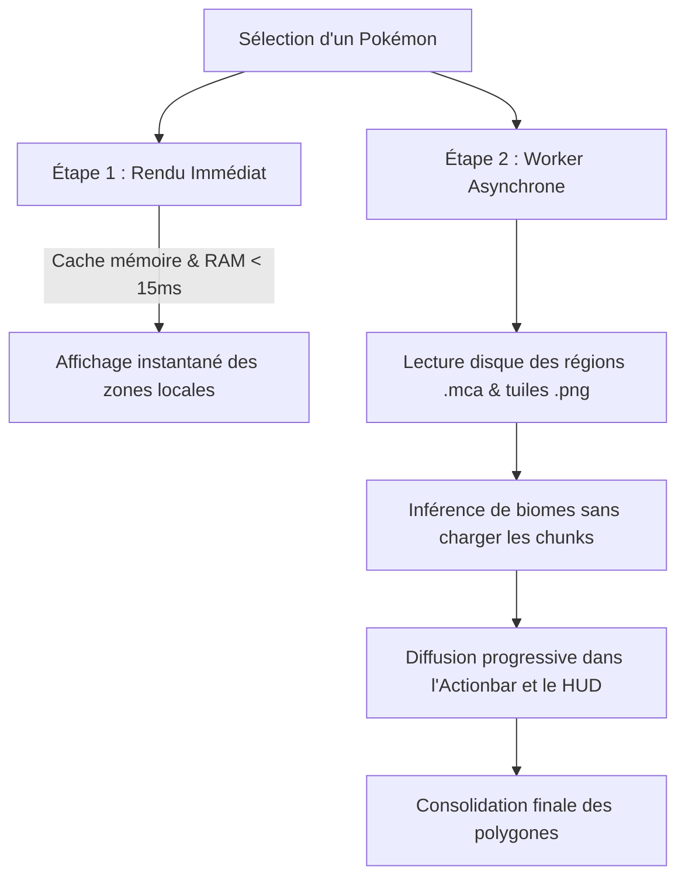

# 🗺️ Intégration Cartographique JourneyMap

Ce document décrit en détail le moteur de rendu, de fusion de polygones et de lecture asynchrone des régions explorées pour JourneyMap.

---

## 📐 1. Moteur de Fusion Géométrique (`ChunkPolygonMerger`)

### Problématique
Une carte explorée peut contenir des dizaines de milliers de chunks éligibles. Créer un `PolygonOverlay` individuel de 16x16 blocs pour chaque chunk génère un quadrillage visuel désagréable et provoque de lourdes chutes de FPS (CPU/GPU bound).

### Solution
`ChunkPolygonMerger` met en œuvre un algorithme 2D d'union géométrique :
1. **Échantillonnage des arêtes** : Chaque chunk $16 \times 16$ possède 4 arêtes orientées.
2. **Annulation des frontières internes** : Deux chunks adjacents partagent une arête de sens opposé ; ces arêtes internes s'annulent mutuellement.
3. **Traçage des contours** : Les segments restants forment les frontières extérieures et les îlots intérieurs.
4. **Simplification colinéaire** : Les sommets consécutifs alignés sont fusionnés en segments uniques, réduisant de 70% à 95% le nombre de sommets finaux.
5. **Résultat** : Un nombre minimal de `MapPolygon` continus et nets, parfaitement lisibles en vue dézoomée.

---

## 🎨 2. Charte Graphique des Raretés (`RarityColorPalette`)

Chaque règle d'apparition possède un seau (`bucket`) ou un poids (`weight`). Le mod catégorise automatiquement les zones selon la classe de rareté :

| Rareté | Code Couleur | Opacité Remplissage | Épaisseur Bordure |
|---|---|---|---|
| **Common** | Vert `#2ECC71` | 0.22 | 1.8 px |
| **Uncommon** | Bleu `#3498DB` | 0.26 | 2.0 px |
| **Rare** | Violet `#9B59B6` | 0.32 | 2.4 px |
| **Ultra-Rare** | Ambre `#E67E22` | 0.38 | 2.8 px |

### Infobulles Riches (Tooltips au survol des zones)
Le survol d'un polygone affiche un panneau récapitulatif complet :
- Nom traduit et type(s) du Pokémon.
- Rareté locale et pourcentage estimé d'apparition.
- Biomes compatibles de la zone.
- Conditions environnementales requises (horaires, météo, altitude).
- Nombre total de chunks regroupés dans le polygone.

---

## ⚡ 3. Pipeline de Scan Asynchrone en Deux Étapes (`SpawnOverlayManager`)

Pour combiner **réactivité instantanée** et **couverture de carte globale persistante** :

### Étape 1 : Rendu Immédiat (< 15 ms)
- Extrait les chunks déjà présents dans le cache mémoire persistant `globalBiomeCache`.
- Affiche instantanément les zones autour du joueur sans bloquer le rendu graphique.

### Étape 2 : Scan Asynchrone Déporté
- Exécuté dans un pool dédié `CobblemonJM-Worker` (2 threads daemons).
- Priorise les régions proches du joueur ($dx^2 + dz^2$), puis parallélise le traitement des régions distantes.
- Envoie des mises à jour de progression régulières (visibles sur la barre de chargement du HUD et l'Actionbar).
